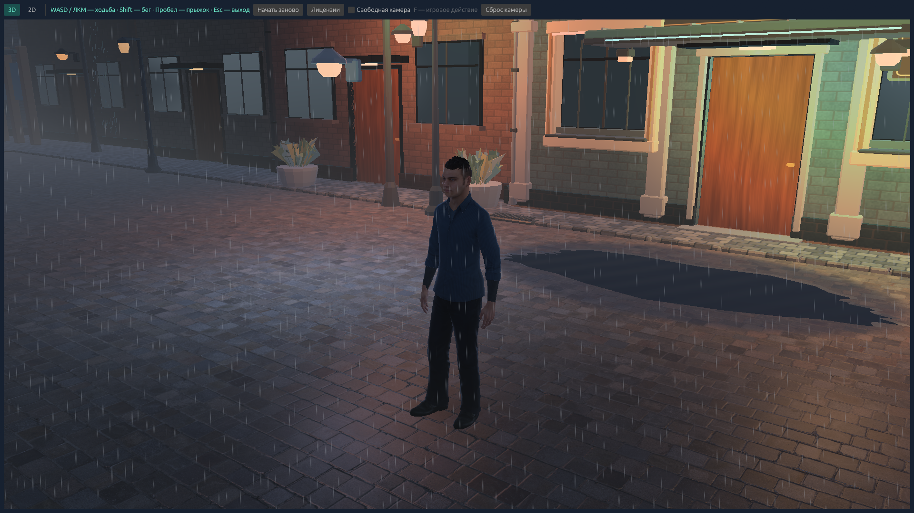

# Студия игр — редактор и движок на Rust



Свой редактор игр под Windows: собираешь 3D-сцену с персонажами, диалогами и заданиями, 2D-карту сверху или платформер, проверяешь прямо в редакторе и собираешь игру в отдельный `.exe`.

- **Стек:** Rust 2024, egui, wgpu (DirectX 12 / Vulkan), WGSL-шейдеры
- **Что внутри:** 3D с тенями, погодой и анимацией персонажей, 2D-режимы, редактор материалов, правила и задания на JSON, контрольные точки, сборка игр в EXE
- **Правки ИИ:** подключённая языковая модель предлагает изменения сцены, а редактор проверяет их в двух сборках, прежде чем применить
- **Размер:** ~200 файлов Rust, около 97 тысяч строк; четыре крейта (`studio-core`, `studio-editor`, `studio-rules`, `robot-studio`)

**Скачать готовый редактор:** раздел [Releases](../../releases) → `robot-studio.exe` (Windows x64).

**Собрать из исходников:**
```
cargo build --release
```

Модели в `demo_assets` — ресурсы с открытыми лицензиями (CC0, CC BY 4.0 и др.), авторы и лицензии перечислены в [demo_assets/README.md](demo_assets/README.md).

---

## Версия 0.23 RC

Локальный редактор под Windows x64 на Rust, egui и wgpu. Можно собрать 3D-сцену с персонажами и заданиями, отдельную карту 2D сверху или платформер. У каждого проекта есть предпросмотр в редакторе и сборка в отдельный `.exe`.

## Запуск

Скачай `robot-studio.exe` из раздела Releases и запусти. На начальном экране можно создать 3D-проект, карту 2D сверху или платформер, открыть файл либо выбрать редактируемый пример. В **«Последнем свете на набережной»** отметь западный пост и восточное реле, открой дверь клавишей `E` и поговори с Лидой. Выбор меняет оставшуюся часть маршрута. `F8` приближает говорящего. `F5` и `F9` сохраняют и загружают контрольную точку в отдельной игре. [Три игры, видео и приёмка](verification/v0.23/REPORT.md)

В **«Правках ИИ…»** выбери набор `.suite.json`, проверь JSON предложения и нажми **«Проверить в двух EXE»**. Редактор экспортирует исходную сцену и отдельную копию, повторяет входные действия и показывает первое расхождение. Поддерживаются начальные сохранения, отдельные ожидания для двух сборок и ручной JSON для работы без модели. [Как повторить проверку и собрать игру](verification/v0.23/EDITOR.md)

В **«Мастерской после дождя»** поговори с Лидой клавишей `E`, пройди к двери, дождись касания ручки и отметь готовность инструмента у верстака клавишей `F`. Для крупного плана в разговоре есть `F8`. Управление камерой и кнопки игры видны над сценой. [Сцены, игры, видео и отчёт 0.22](verification/v0.22/REPORT.md)

**«Мастер игры»** находится справа от сцены. Опиши игру, обсуди решения с подключённой моделью и отредактируй план. Есть ручной план для работы без ИИ. Можно собрать 3D-мастерскую в трёх вариантах, 2D-маршрут сверху или платформер с сигналами, таймером и новой попыткой. Результат редактируется как обычная сцена, а сборка по плану отменяется одним действием. В **«Правках ИИ…»** можно отдельно предложить изменение порога условия, повторить записанный сценарий и применить его к сцене.

В **«Сосновом меридиане»** три связанные локации. В отдельной игре `F5` сохраняет текущую локацию и прогресс предыдущих, `F9` загружает сохранение. При повторном запуске того же EXE последний сохранённый маршрут восстанавливается. В **«Липовом проезде»** прежний 3D-квест можно пройти и в **«2D → План»**, с общим положением, инвентарём и этапом задания.

**«Правки ИИ…»** принимает описание для подключённой текстовой модели или редактируемый JSON. Проверка ссылок показывает значения до и после. **«Сравнить по записанной проверке»** прогоняет текущую версию сцены и предложение с начала по одному `.check.json`. Кнопка **«Принять правки»** применяет всю группу с одним шагом отмены. **«Правила» → «Расширения проекта»** импортирует манифесты действий и инструментов. **«Новый…» → «Сгенерировать закрытую карту…»** создаёт редактируемый 2D-уровень с проверенным маршрутом от старта до выхода. [Сцены, EXE и отчёт 0.21](verification/v0.21/REPORT.md)

У выбранной GLB-модели открой **«Граф материала…»** и собери цвет, шероховатость, металличность, масштаб текстуры и свечение из узлов. Посмотри поверхность в режиме **«На улице»** и **«В помещении»**. На вкладке **«Эффекты»** создаются дым, пыль, дождь, брызги и следы. Эффект можно сохранить в `.effect.json`, перенести и включить из правила или по метке анимации. [Отчёт 0.19](verification/v0.19/REPORT.md)

В сцене [«Липовый проезд» с лицевой анимацией](verification/v0.20/linden-cast.robot.json) у Марины есть дорожка моргания и движения рта. Открой **«NPC» → «Марина» → «Диалог» → «Лицевая анимация»** и выбери канал GLB-модели. Импорт совместимых клипов находится во вкладке **«Персонаж»**, WAV и материалы шагов во вкладке **«Звук»**. [Отчёт 0.20](verification/v0.20/REPORT.md)

Выбери **«Новый…» → «Мельница у реки»**, чтобы настроить ящик, плиту, воду и мельницу. **«Окружение» → «Физика»** редактирует тела и датчики. **«Среда»** задаёт время суток, переходы погоды, ветер и воду. В правилах **«Физика и среда»** связывает контакт, погоду, уровень воды и оборот мельницы с действиями. **«Река сверху»** повторно использует систему воды на отдельной 2D-карте. [Отчёт 0.18](verification/v0.18/REPORT.md)

В **«Проверки…»** запиши прохождение для 3D или игр с движением в реальном времени в 2D. `F6` запоминает выбранное состояние на маршруте. После изменения правила повтор показывает первое расхождение и журнал. **«Тактика»** на пустой карте сверху добавляет бойцов, очки действия, препятствия и цель. **«Правила» → «Связанные сцены»** позволяет включить сохранённый уровень в игру и выбрать его в действии перехода. [Отчёт 0.17](verification/v0.17/REPORT.md)

В верхней строке **«Отменить»** и **«Повторить»** работают для целого мазка, перетаскивания, замены GLB и применения пакета. Клавиши `Ctrl+Z` и `Ctrl+Y` управляют историей сцены вне текстовых полей. После правки появляется **«Изменено»**. **«Проект» → «Восстановить автосохранение…»** открывает отдельные копии. `Ctrl+F` ищет объекты, правила и ресурсы. Фильтр **«Только ошибки»** открывает проблемное правило или объект. `F10` показывает профиль качества и замеры процесса в редакторе и игре. Профиль применяется при следующем запуске. [Отчёт 0.16](verification/v0.16/REPORT.md)

В 3D используется сглаживание MSAA 4×, анизотропная фильтрация текстур и тени от дневного света. Искры подсвечивают пол и близкие поверхности. При движении редактор плавно переключает клипы, назначенные персонажу.

У Эммы и Райана отдельные записанные движения ходьбы и бега. При шаге по земле движок удерживает опорную стопу и подстраивает положение бедра и колена. Волосы и свободные края одежды отклоняются при разгоне, повороте, торможении и приземлении.

Чтобы заново открыть начальную сцену, выбери **«Новый…» → «Липовый проезд»**. В том же меню доступны пустые **«2D сверху»** и **«2D сбоку»**, **«Городская улица»**, **«Каменный двор»**, пустая сцена, демо-робот, демо-слизень и **«Демо материалов»**. [Демонстрации 0.15](verification/v0.15/REPORT.md) · [Проверка 0.14](verification/v0.14/REPORT.md) · [Исходный квартал 0.13](verification/v0.13/REPORT.md)

Проекты прежних версий открываются через **«Открыть…»**. При загрузке старые ответы получают стабильные идентификаторы, чтобы их можно было использовать в правилах. Для проекта без правил редактор создаёт пустой набор. [Отчёт по 0.11 с замерами и видео](verification/REPORT.md)

Для сборки из исходников нужны Rust (MSVC), Visual C++ Build Tools и Windows SDK. Команду запускай из папки проекта.

```powershell
cargo build --release --locked
```

На этом ПК инструменты Rust установлены отдельно от системного PATH. Если PowerShell не видит `cargo`, выполни в нём следующие команды перед сборкой.

```powershell
$studioTools = Join-Path $env:LOCALAPPDATA 'Codex\RobotEngineTools'
$env:RUSTUP_HOME = Join-Path $studioTools 'rustup'
$env:CARGO_HOME = Join-Path $studioTools 'cargo'
$env:Path = (Join-Path $env:CARGO_HOME 'bin') + ';' + $env:Path
```

## Внешность 3D-персонажа

Останови игру и выбери **«Персонаж» → «Лицо и одежда…»** в демо. В новой сцене нажми **«Создать реалистичного героя…»**. В строке **«Основа»** выбери **«Эмма»** или **«Райан»**. Можно изменить имя, рост, ширину лица и челюсти и длину носа.

- В разделе **«Мимика»** есть готовые выражения **«Спокойно»**, **«Улыбка»** и **«Удивление»**. Ползунки **«Улыбка»**, **«Брови»**, **«Рот»** и **«Прищур»** позволяют настроить выражение вручную.
- В списке **«Причёска»** есть **«Исходная»**, **«Короткая»**, **«Объёмная»** и **«Зачёс набок»**. Объём волос настраивается отдельно.
- В списке **«Фасон»** есть **«Исходный комплект»**, **«Свитер»** и **«Длинное пальто»**. Можно изменить посадку и цвета верха и брюк.

Нажми **«Применить внешность»**, затем **«К лицу»** или **«В полный рост»**, чтобы рассмотреть результат. Изменённая внешность сохраняется вместе со сценой. Эмма и Райан используют Microsoft Rocketbox по лицензии MIT. Майя и Алексей доступны в списке основ для прежних проектов. [Лицензии и внесённые изменения](demo_assets/README.md)

## NPC, маршруты и задания

1. Открой вкладку **«NPC»** и нажми **«+ Создать NPC»**. Выбери **«Женщина — Эмма»**, **«Мужчина — Райан»** или **«Копия героя»**. Последний вариант использует 3D-модель и настройки текущего героя. Кнопка **«Лицо и одежда NPC…»** открывает настройки выбранного персонажа.
2. В разделе **«Маршрут»** отредактируй точки, скорость и время ожидания. **«+ Точка»** добавляет следующую остановку. Можно включить **«Добавлять точки кликом на плане»** и расставить остановки в **«2D» → «План»**. Меню **«Маршрут через дом»** заменяет текущий маршрут проходом с улицы в выбранный дом.
3. В разделе **«Диалог»** нажми **«Создать диалог»**. Создай реплики через **«+ Реплика»** и добавь варианты через **«+ Ответ игрока»**. Для каждого ответа выбери следующую реплику или **«Завершить разговор»**.
4. В разделе **«Задания»** нажми **«+ Задание»**. Для цели **«Дойти до места»** нажми **«Указать цель на 2D-плане»** и щёлкни по сцене. Координаты и радиус можно подправить числом. Для цели **«Поговорить с персонажем»** выбери собеседника. Заполни подсказку и сообщение о выполнении, затем укажи задание в том ответе диалога, который должен его запустить.

В режиме **«Играть»** NPC идут по маршрутам, могут входить в дома и останавливаются на время разговора. У цели **«Дойти до места»** появляется метка. Реплики и задания сохраняются вместе со сценой. **«Играть»** начинает проверку с начала. **«Продолжить»** восстанавливает последнюю контрольную точку.

## Правила без кода

Останови игру и открой **«Правила» → «Сценарии» → «+ Правило»**. Укажи название и в разделе **«Когда»** выбери событие и объект, например взаимодействие с конкретной дверью. В **«Если»** добавь нужные условия, в **«Тогда»** — действия. Правило запускает действия, когда выполняются все его условия. Пустой раздел **«Если»** пропускает проверку условий. Флажок **«Только один раз»** ограничивает повторное срабатывание.

| Раздел | Доступные варианты |
| --- | --- |
| **«Когда»** | **«Поднят предмет»**, **«Выбран ответ NPC»**, **«Взаимодействие с дверью»**, **«Вход в зону»**, **«Игровое действие»**, **«Таймер истёк»** |
| **«Если»** | **«Есть предмет»**, **«Значение флага»**, **«Сравнение счётчика»**, **«Игрок в зоне»** |
| **«Тогда»** | **«Установить флаг»**, **«Отпереть дверь»**, **«Задать этап задания»**, **«Задать счётчик»**, **«Прибавить к счётчику»**, **«Запустить таймер»**, **«Остановить таймер»**, **«Включить или выключить объект»**, **«Перезапустить попытку»** |

- В **«Флаги» → «+ Флаг»** создай состояние, например разрешение от NPC. Укажи имя и исходное значение в поле **«Включён при запуске»**. Списки в правилах используют эти имена.
- В **«Зоны» → «+ Зона»** задай положение и размер области. `Y` задаёт её нижнюю границу. Чтобы реагировать на вход в конкретный дом, выбери его в **«Привязка к дому»**. Кнопка **«По размеру дома»** устанавливает границы, которые можно уточнить вручную. Выделенная зона видна на плане.
- Чтобы дверь открывалась по сценарию, выбери дом в **«Окружение»**, включи **«Дверная створка»** и **«Заперта до выполнения правила»**. Укажи эту дверь в действии **«Отпереть дверь»**. Событие взаимодействия обрабатывается при нажатии `E`, в том числе у запертой двери.
- Чтобы вести задание по этапам, выбери в **«NPC» → «Задания»** цель **«По правилам»** и укажи **«Финальный этап»**. Действия **«Задать этап задания»** меняют текущий номер этапа. Задание завершается при достижении финального этапа.
- Создай счётчик на вкладке **«Счётчики»** и отсчёт на вкладке **«Таймеры»**. В игре над картой видны значения счётчиков, активные таймеры и состояние задания. В предпросмотре видны последние срабатывания правил, блокировки и повторы одноразовых правил. Клавиши `F` и `R` создают события **«Отметить»** и **«Повторить попытку»**. Назначь на них действия в правилах проекта.

В **«Липовом проезде»** можно изменить условие правила **«Допуск в мастерскую»**. Открой список **«Есть предмет»** и выбери **«Значение флага» → «Допуск от Ильи»**. Оставь условие **«Поручение Марины»**. После нового запуска прими поручение у Марины, поговори с Ильёй и выбери **«Назвать поручение Марины»**. Его ответ установит флаг, по которому дверь сможет отпереться. Такой вариант использует ту же дверь, область за порогом и финальный этап задания.

### Шаблон двух отметок

1. В **«Правила» → «Библиотека»** нажми **«Сохранить шаблон»**, задай имя счётчика и подписей отметок. Укажи путь `.rules.json` и нажми **«Сохранить библиотеку»**. В другой сцене укажи этот путь и нажми **«Открыть библиотеку»**.
2. Назначь два разных источника. Можно выбрать **«Вход»** для двух зон или **«F в зоне»** для отметок по клавише. Среди целей доступны открытие двери, включение объекта и этап задания.
3. Нажми **«Применить шаблон»**. В сцене появятся счётчик и правила для двух отметок и награды. Повтор одной отметки не прибавляет очко. Библиотека хранит шаблон и подписи. Источники и цель назначаются заново, поскольку у дверей, объектов и областей в другом проекте свои идентификаторы. [Готовая библиотека](verification/v0.14/two-marks.rules.json)

## Самостоятельные карты 2D

1. Выбери **«Новый…» → «2D сверху»** или **«2D сбоку»**. В правой панели задай число столбцов и строк. В **«Тайлы»** выбери **«Импорт PNG…»**, укажи ширину и высоту ячейки или включи **«Весь PNG как один тайл»**. Готовый пример атласа использует ячейку 32 × 32. [Атлас покрытия](demo_assets/map2d/terrain.png)
2. Выбери тайл и покрась карту мышью. **«Покрытие»** задаёт основу, **«Декор»** рисуется поверх неё, **«Высокие объекты»** можно частично закрывать героем. Колесо меняет масштаб, правая кнопка мыши сдвигает карту. **«Вписать карту»** возвращает общий вид.
3. Открой **«Столкновения»** и отдельно нарисуй **«Стену»**. **«Без столкновения»** снимает ограничение, сохраняя тайл. В боковом режиме **«Односторонняя платформа»** пропускает героя снизу и удерживает при падении сверху. Пустота между участками земли образует провал.
4. В **«Старт»** щёлкни по стартовой клетке. В режиме сбоку открой **«Точка возрождения»** и выбери свободную клетку над твёрдой землёй. Герой активирует её при проходе. Пока он до неё не дошёл, падение возвращает к старту.
5. В панели карты создай **«Зоны»** для событий и **«Метки»** для объектов, которыми управляют правила. Пример финиша использует **«Вход в зону» → «Задать этап задания»**. В карте сверху используй `WASD` или стрелки. В платформере используй `A` и `D` или стрелки, для прыжка нажми `Пробел`.

Оба режима используют тайловые поля, свой старт и собственные коллизии. **«2D → План»** в трёхмерном проекте показывает ту же 3D-сцену сверху с её окружением и прогрессом.

В **«Тайлы»** и **«Столкновения»** доступны **«Карандаш»**, **«Прямоугольник»** и **«Заливка»**. Прямоугольник применяется при отпускании кнопки мыши. Заливка меняет одинаковые клетки, соединённые сторонами, в выбранном слое. Для переноса фрагмента открой **«Участок карты»**, выбери слои тайлов, коллизии или оба варианта и выдели область мышью. Нажми **«Вставить участок»** и щёлкни по клетке для его левого верхнего угла. Пустые клетки тоже переносятся. Вставка у края обрезается по границе карты.

## Квест с ключом

Можно открыть готовую сцену [«Ключ от комнаты»](verification/v0.12/room-key.robot.json). Порядок проверки и запись собраны в [отчёте по 0.12](verification/v0.12/REPORT.md).

1. Выбери **«Новый…» → «Пустая сцена»**. Создай героя на вкладке **«Персонаж»** и собеседника на вкладке **«NPC»**.
2. В **«Окружении»** построй дом и включи **«Дверная створка»**. Нажми **«+ Ключ»**, задай имя и выбери **«Поставить на 2D-плане»**. Щёлкни по доступному месту снаружи.
3. Снова выбери дом. В строке **«Ключ для двери»** назначь созданный ключ. Для внутренней двери такой же список доступен в настройках её перегородки.
4. В **«NPC → Задания»** создай задание с целью **«Войти через дверь»** и выбери дом. В **«NPC → Диалог»** добавь два ответа. Согласие свяжи с заданием, для отказа оставь **«Без задания»**.
5. Нажми **«Играть»**. Клавиша `E` используется для разговора, проверки замка, подбора ключа и открытия двери. Щелчок по земле ведёт героя к точке в 3D и на плане. Задание срабатывает при входе в выбранный дом с улицы. Ключ остаётся у героя при смене вида.

## Сборка отдельной игры

Останови игру. Для 3D-сцены выбери стартовый вид **«3D»** или **«2D → План»**. Для отдельной 2D-карты вид задаётся при создании. Нажми **«Собрать игру для Windows»** в верхней панели и укажи имя с расширением `.exe`. В файл входят сцена, правила, используемые GLB и PNG-атласы 2D-карты. Его можно перенести в отдельную папку и запустить на Windows x64 с поддерживаемым графическим драйвером. При запуске начинается новое прохождение. В игровой панели доступны **«Начать заново»** и **«Лицензии»**. 3D-игра также позволяет переключаться на план.

## Персонаж и окружение

- Чтобы создать человека из деталей, выбери **«Персонаж» → «Собрать персонажа…»**. Настрой рост, ширину плеч и цвета кожи, волос и одежды, затем нажми **«Создать из деталей»**. После сборки каждую деталь можно редактировать отдельно. Сборка заменяет текущего персонажа и его ключи анимации.
- Во вкладке **«Персонаж»** добавь блок, сферу или цилиндр. Выбери деталь в списке, чтобы справа изменить её размер, позицию, поворот и цвет. В поле **«Движение при ходьбе»** можно назначить роль руки, ноги или стопы. Движок будет автоматически двигать эти детали при ходьбе и беге.
- Чтобы сделать анимацию по ключам, выбери момент на шкале времени, нажми **«Добавить ключ»** и укажи смещение или поворот детали. Поставь следующий ключ и нажми **«Воспроизвести»**. Движение между ключами рассчитывается автоматически.
- Укажи цвет, число частиц, силу и длительность. **«Проверить эффект»** запускает искры сразу. **«Метка эффекта»** задаёт момент их запуска при воспроизведении анимации.
- Для своего дома нажми **«Окружение» → «Построить дом»**. Справа настрой позицию пола, ширину, высоту, глубину и цвет стен. Поле **«Фасад»** поворачивает дом с шагом 90°. У **«Дверного проёма»** можно менять ширину, высоту и положение. Редактор пересчитывает стены и их столкновения. В **«Плане»** крыша скрыта, чтобы был виден интерьер.
- Во вкладке **«Окружение»** добавь платформу, стену, ящик, дерево или камень. Укажи позицию, размер и цвет. Флажок **«Столкновения»** позволяет сделать объект препятствием или опорой для прыжка. Для дерева используется форма ствола.

## Комнаты и мебель

Во вкладке **«Окружение»** выбери дом в списке и найди справа раздел **«Интерьер»**.

- **«+ Перегородка»** добавляет внутреннюю стену. Настрой её длину, позицию и направление. Флажок **«Открытый проход»** добавляет проём. Его ширину, высоту и смещение можно изменить отдельно от входа с улицы.
- В параметрах входа и внутреннего проёма есть флажок **«Дверная створка»**. Флажок **«Открыта при запуске»** задаёт её исходное положение. Закрытая створка преграждает путь. В игре клавиша `E` рядом с дверью открывает или закрывает её. Старые сцены с проёмами без створок сохраняют свободный проход.
- **«+ Мебель»** добавляет стул, стол, кровать, диван или шкаф. Выбери предмет в списке, чтобы изменить размер, поворот, положение и цвет. Флажок **«Столкновения»** определяет, будет ли предмет преградой для героя.
- В **«2D» → «План»** щёлкни по мебели левой кнопкой мыши, затем удерживай `Shift` и щёлкни по новому месту внутри того же дома. Проверь расстановку кнопкой **«Играть»**. Столкновения, двери и посадка на мебель работают и на плане, и в 3D.

## Спрайты и вид сверху

Выбери **«Персонаж» → «Рисовать спрайт»**. В режиме **«Сбоку / спрайт»** можно рисовать **«Кистью»**, стирать пиксели **«Ластиком»** и менять цвет. Выбери ракурс и кадр. Кнопка **«+ Кадр»** копирует текущий кадр, всего доступно до восьми. Поле **«кадр/с»** задаёт скорость воспроизведения. Чтобы использовать персонажа из деталей как основу, сними флажок **«Только рисунок»**.

Если в сцене есть 3D-персонаж, переключись на **«2D» → «Сбоку / спрайт»**. Выбери клип, ракурс, кадр и момент на шкале времени, затем нажми **«Кадр из 3D»**, чтобы перенести одну позу. **«Клип в 8 кадров»** автоматически создаёт восемь кадров выбранного клипа для текущего ракурса. Готовые кадры можно дорисовать кистью. Повторная генерация обновляет изображение из 3D и сохраняет ручные штрихи.

**«Экспорт спрайтов…»** сохраняет атлас ракурсов в PNG.

Для прогулки по той же площадке сверху выбери **«2D» → «План»**. В плане действуют те же стены, дверные проёмы и столкновения, что и в 3D. Автоматические спрайты героя и NPC имеют 128 × 128 пикселей и восемь ракурсов. На плане используются слегка приподнятая камера и масштаб по росту персонажа.

## Персонаж с готовым скелетом в 3D

Во вкладке **«Персонаж»** нажми **«3D-персонаж…»** и выбери `.glb` с моделью, скелетом, клипами и встроенными текстурами. Кнопка **«Рыцарь»** добавляет встроенную модель. Справа выбери, какие клипы использовать для состояний **«Покой»**, **«Ходьба»**, **«Бег»** и **«Прыжок»**. Нажми **«Играть»**, чтобы проверить смену клипов при движении. Художники и лицензии перечислены в [описании примеров](demo_assets/README.md).

Для просмотра клипа в редакторе раскрой **«Оживить персонажа»**, выбери состояние и нажми **«Проиграть на месте»**. Чтобы добавить своё движение поверх клипа, открой **«Ключи позы»**, выбери кость и момент на шкале времени. Нажми **«+ Ключ позы»** и настрой её поворот по осям X, Y и Z. Добавь следующий ключ в другом месте шкалы, чтобы редактор рассчитал движение между ними.

В игре персонажи поворачивают голову к собеседнику, двигают плечами и кистями при ходьбе и имитируют дыхание. Встроенные профили задают подвижные области волос и одежды. Движок считает их отклонение с учётом ускорения, поворота, тяжести и затухания. Прищур и объём волос настраиваются в окне внешности.

### Библиотека персонажей

Открой **«Персонаж» → «Библиотека персонажей» → «Сохранить персонажа в библиотеку…»**. Файл `.character.json` хранит внешность, назначенные клипы, сменные детали и нарисованные или перенесённые кадры. Если рядом появилась папка `.character.assets`, копируй её вместе с файлом. В другом проекте выбери роль **«Игрок»**, **«NPC»** или **«Декоративный персонаж»**, затем нажми **«Разместить из библиотеки…»**. Маршрут, диалоги и задания NPC задаются в принимающем проекте.

В разделе **«Сменные детали GLB»** выбери часть тела или одежды и нажми **«Импорт совместимой детали…»**. Деталь должна иметь веса и совместимые кости исходной модели. Для отдельной 2D-карты размести персонажа в роли **«Игрок»**, выбери **«Рисовать спрайт» → «Клип в 8 кадров»**, при желании дорисуй кадры и нажми **«Вернуться к карте»**. При повторном переносе клипа ручные штрихи сохраняются.

## Модели и материалы в 3D

- Для быстрого примера выбери **«Новый…» → «Демо материалов»**. В сцене появятся деревянные ящики и скала с текстурами. Эти модели также доступны по одной через **«Окружение» → «Демо-модели»**. Авторы и лицензия указаны в [описании примеров](demo_assets/README.md).
- Для своей модели выбери **«Окружение» → «Импорт GLB…»**. Подходит один статический файл glTF 2.0 в формате `.glb` размером до 64 МБ со встроенными PNG или JPEG. Отрисовка использует основной цвет, шероховатость, металличность, карты нормалей и свечения. Для вырезов в текстуре поддерживается режим glTF `MASK`.
- Выбери модель в списке и настрой позицию, поворот и масштаб. **«К объекту»** приближает её камерой. В **«Материалы GLB»** можно настроить повтор текстур по `U` и `V`, шероховатость, силу карты нормалей и свечение. Во вкладке **«Свет» → «Освещение сцены»** регулируются дневной свет и интенсивность света внутри.
- Флажок **«Столкновения по габаритам»** добавляет физические границы модели. Для мебели включи **«Отдельный коллайдер»** и задай его центр и размер. В **«Точка посадки»** укажи место и поворот посадки и место, куда герой встанет. Герой садится и встаёт по `E`. **«Заменить модель GLB…»** меняет внешний ресурс с сохранением размещения, настроек материала, коллайдера и посадки.

## Проверка игры и сохранение

| Действие | Управление |
| --- | --- |
| Ходьба в 3D | `W` / `A` / `S` / `D`, стрелки или щелчок по земле. Направление клавиш зависит от поворота камеры. |
| Ходьба в 2D на плане | `W` / `A` / `S` / `D`, стрелки или щелчок по точке назначения. |
| Ходьба на отдельной карте 2D сверху | `W` / `A` / `S` / `D` или стрелки. |
| Платформер 2D | `A` / `D` или `←` / `→`, `Пробел` для прыжка. |
| Игровые действия из правил | `F` для отметки, `R` для повтора попытки. Сценарий проекта назначает этим событиям действия. |
| Бег и прыжок | Удерживай `Shift` для бега, нажми `Пробел` для прыжка. При приземлении срабатывает настроенный эффект. |
| Взаимодействие | `E` (`У` в русской раскладке) рядом с собеседником, предметом, дверью, стулом или диваном по подсказке на экране. Нажми ту же клавишу сидя, чтобы встать. |
| Камера в 3D | Перетаскивай мышью с зажатой левой кнопкой, чтобы осмотреться. Колесо меняет расстояние до персонажа. |
| Свободная камера | В 3D-предпросмотре редактора включи **«Свободная камера»**. `WASD` перемещают камеру, `Page Up` и `Page Down` меняют высоту, `Shift` ускоряет движение. ЛКМ вращает вид, ПКМ сдвигает камеру. `Esc` возвращает управление героем. |
| Панели в игре | Боковые панели и шкала времени скрыты по умолчанию. Флажок **«Панели»** возвращает их. |
| Выход из игры | `Esc` сначала закрывает открытый разговор или режим свободной камеры. Следующее нажатие возвращает в редактор или закрывает отдельную игру. В редакторе можно нажать **«Стоп»**. |

Режим включается кнопкой **«Играть»** и работает с полом, стенами и платформами в 2D и 3D. В 3D-редакторе правая кнопка мыши сдвигает камеру. **«К детали»** фокусирует камеру на выделенной детали персонажа, **«Сброс камеры»** возвращает стандартный вид.

**«Сохранить»** и **«Сохранить как…»** записывают окружение, карту 2D с PNG-атласами, персонажей, маршруты, диалоги, задания, правила, эффекты и спрайты в `.robot.json`. Пользовательские GLB копируются в соседнюю папку с ресурсами. Например, при сохранении `scene.robot.json` редактор создаёт `scene.robot.assets`. При переносе редактируемой сцены скопируй файл и папку вместе. Встроенные демо-модели хранятся в редакторе.

Чтобы продолжить работу, выбери **«Открыть…»**. **«Сохранить»** в игре записывает позицию, инвентарь, двери и состояние правил. В платформере сохраняется активная точка возрождения. После повторного открытия нажми **«Продолжить»**.

## Черновик по описанию

Открой **«Нейросети…»**, выбери сервер с текстовой моделью, проверь адрес и имя модели. Опиши персонажа, например робота, слизня или зверька, и нажми **«Создать черновик»**. После предпросмотра нажми **«Применить персонажа»**. Редактор заменит прежнего персонажа и его анимацию на текущей площадке.

| Сервер | Адрес по умолчанию |
| --- | --- |
| Strata | `http://127.0.0.1:8082/v1` |
| llama.cpp | `http://127.0.0.1:8080/v1` |
| Ollama | `http://127.0.0.1:11434/v1` |
| LM Studio | `http://127.0.0.1:1234/v1` |
| Облачный API | Укажи HTTPS-адрес OpenAI-совместимого API и имя модели. Если сервис требует авторизацию, введи ключ в поле **«API-ключ»**. Описание отправляется выбранному сервису. |

Адреса редактируются. Для Strata с установленным пресетом `SC117-IQ2-64K` можно запустить сервер на порту `8082`. Этот порт выбран для запуска рядом с сервером генерации изображений на `8080`.

```powershell
strata launch --preset SC117-IQ2-64K --port 8082 --no-tui
```

Моделирование, анимация, эффекты, сохранение и игровой режим доступны локально без подключения к ИИ.

## Границы версии 0.15

Предпросмотр и отдельная игра используют одного управляемого героя. NPC ходят по указанным точкам. Логика задаётся списками событий, условий и действий. Карты 2D ограничены 96 × 96 клетками и 8 МБ PNG-данных. Платформер поддерживает одну точку возрождения на карту. Коллайдеры импортированной мебели задаются прямоугольным объёмом, посадка задаётся точками. Фасоны и причёски меняют геометрию подготовленных моделей. Пружинная симуляция волос и ткани рассчитана на размеченные участки меша. Полные столкновения ткани и волос с телом, перенос анимации на произвольный скелет и сортировка полупрозрачных материалов остаются за рамками версии.
